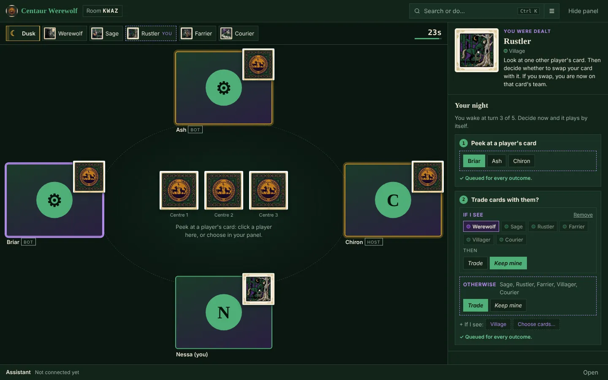

# Centaur Werewolf

A one-night hidden-role game for 3 to 12 players, built on [Convex](https://convex.dev) and React. Werewolves and
their allies hide among the Centaurs, and the creatures of the Wildwood play their own game alongside; everyone acts
once in the night, talks in the day, and votes once. AI assistants can play a seat over MCP.

What is different from a table-top night:

- **Timed night turns.** Every role in the deck gets one turn of exactly the same length, whether a player holds it or
  it lies in the centre. Everyone sees which turn is happening and the same countdown.
- **Queued moves.** Decide your night action before your turn; it plays by itself. A step that follows a peek can
  branch on what you will see ("if Werewolf team → keep mine, otherwise → trade").
- **Forced random moves.** Anything still undecided when your turn ends is chosen at random, and marked so in the log.
- **A journal.** What you did and learned stays on screen through the day, pinned to the seats it concerns.
- **One command registry.** Every action is declared once and reaches the server, the command palette (`Ctrl/⌘ K`),
  the buttons and the MCP tools from that one declaration.
- **Rule variants as room settings.** Blood Price, the Den Census, dawn proclamations and other table rules are set
  in the lobby and shown to every player (`setup.setRule`).



More: [command palette](docs/screenshots/palette.webp), [seven players](docs/screenshots/night-seven.webp), [results and log](docs/screenshots/ended.webp).

## Run it

```bash
npm install
```

```bash
npm run dev
```

`npm run dev` starts Convex and Vite together. The first run asks you to log in to Convex or choose a local
deployment, and writes `VITE_CONVEX_URL` to `.env.local`. Without an account:

```bash
CONVEX_AGENT_MODE=anonymous npx convex dev
```

Other scripts: `npm test` (engine and registry tests), `npm run typecheck`, `npm run build`.

Play-testing against a running backend (`sim/`):

```bash
npx tsx sim/smoke.ts                                   # a whole game over MCP, plus auth checks
npx tsx sim/baseline.ts sim/tournaments/stage2-mechanics.json 20000   # random-play baselines per deck and rules
npx tsx sim/deal-uniformity.ts 2000                    # deal uniformity through the real server
npx tsx sim/tournaments/make-stages.ts                 # regenerate the play-test deck files
```

To try it alone, create a room, add two or more practice bots, and start. Bots never decide anything, so they play the
forced random moves.

## Where things are

| Path | What |
| --- | --- |
| `shared/roles.ts` | Roles as data: team, night steps built from primitive effects, vote modifiers, win rule |
| `shared/settings.ts` | Table rule variants, their defaults and descriptions |
| `shared/engine.ts` | Pure game logic: deal, plans, running a night script, forced moves, dawn, the vote, who wins and why |
| `shared/commands.ts` | The command registry, `availability()`, and `toolDefinitions()` for MCP |
| `convex/mcp.ts`, `convex/agent.ts` | The MCP server and what an assistant reads |
| `convex/presence.ts` | Heartbeats, liveness and the gate every command, view and future media channel goes through |
| `convex/commands.ts` | The single `run` mutation every change goes through |
| `convex/rooms.ts` | The per-viewer room query: the only place hidden information leaves the server |
| `convex/game.ts`, `convex/timers.ts` | Turn and day transitions, and their scheduled ends |
| `src/palette/` | The command palette and its argument pages |
| `src/components/` | Shell (layout), Table (the circle), PlanBuilder (conditional plans), SidePanel |
| `public/art/` | Character art |
| `sim/` | Play-test harness: smoke test, baselines, deal check, AI tournaments (`arena.ts`) |

See [docs/architecture.md](docs/architecture.md) for the roster and wake order, the primitives, the rule settings,
the order in which a game is decided, how to add a role, and secrecy. The design rationale is in
[docs/design/synthesis.md](docs/design/synthesis.md); the owner's binding requirements in [docs/design/owner-directions.md](docs/design/owner-directions.md).
